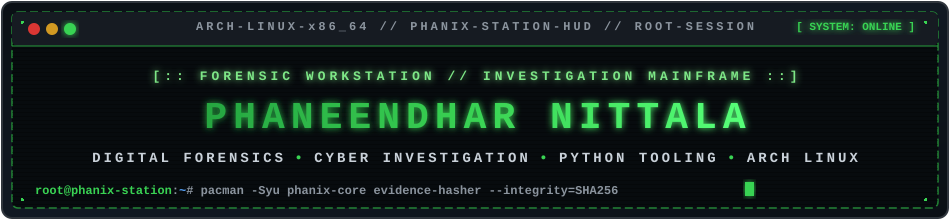
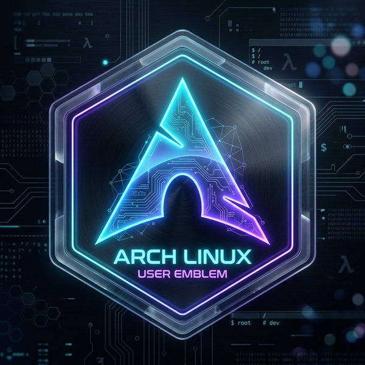
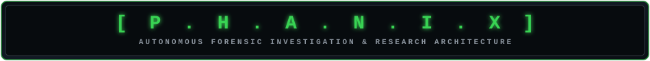
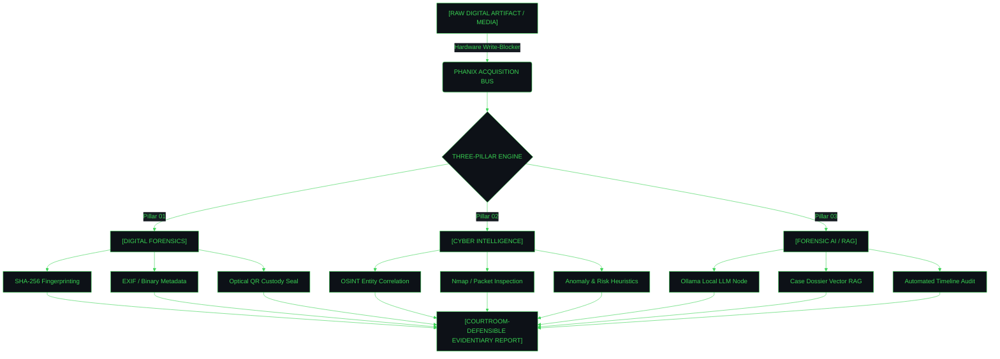
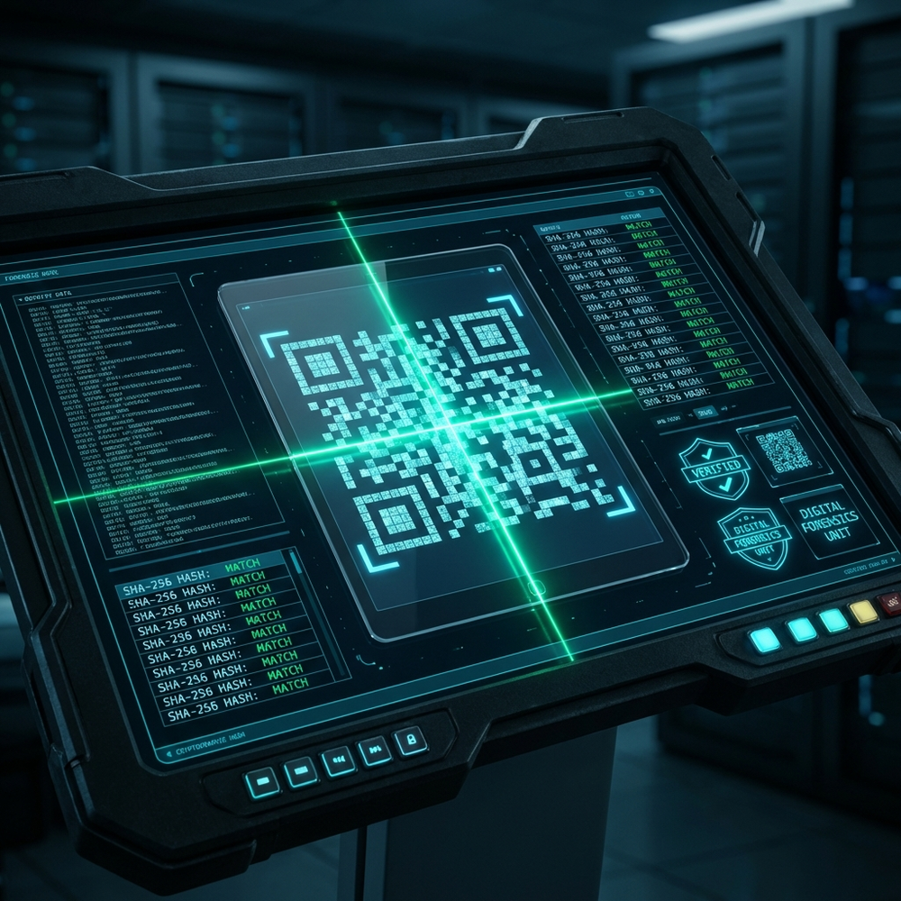
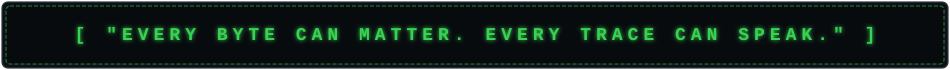
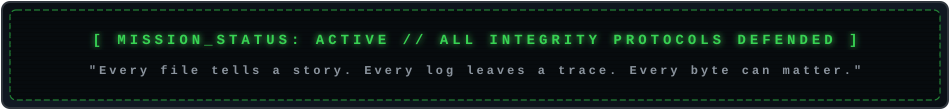

<div align="center">

<!-- ===================================================================== -->
<!-- 00 // RETRO MAINFRAME CASSETTE HEADER & BRAND EMBLEM                  -->
<!-- ===================================================================== -->
<a href="https://github.com/NPhaneendhar">
  
</a>

<br><br>

<a href="https://github.com/NPhaneendhar">
  
</a>

<br><br>

<!-- RETRO CRT MONOSPACE TYPEWRITER -->


<br><br>

<!-- RETRO TERMINAL CONTROL PANELS / PRIMARY LAUNCH MATRIX -->
<p>
  <a href="https://nphaneendhar.github.io/phaneendhar-nittala-portfolio/"></a>
  <a href="https://nphaneendhar.github.io/P.H.A.N.I.X-FORENSIC-QR-ARCHITECT"></a>
  <a href="https://p-h-a-n-i-x-investigation-e-xpert.vercel.app"></a>
</p>
<p>
  <a href="https://p-h-a-n-i-x-python-learn.vercel.app"></a>
  <a href="https://nittala-forensic-suite.vercel.app"></a>
  <a href="https://www.linkedin.com/in/phaneendhar-nittala-a2a3443a1/"></a>
  <a href="mailto:nittalaphaneendhar@gmail.com"></a>
</p>

<!-- LIVE TELEMETRY & KERNEL STATUS COUNTERS -->
<p>
  
  &nbsp;
  
  &nbsp;
  
  &nbsp;
  
  &nbsp;
  
</p>

</div>

<!-- ===================================================================== -->
<!-- LIVE MEMORY HEX DUMP & MULTI-COLOR CRT DIAGNOSTIC READOUT             -->
<!-- ===================================================================== -->
```diff
+ ┏━━━━━━━━━━━━━━━━━━━━━━━━━━━━━━━━━━━━━━━━━━━━━━━━━━━━━━━━━━━━━━━━━━━━━━━━━━━━━━━━━━━━━━━━━━━━━━━━━━━━━━┓
+ ┃ [SYS_BOOT] PHANIX FORENSIC MAINFRAME v4.2 // GENESIS MEMORY SECTOR 0x0000 -> 0x003F [MOUNT: RO]     ┃
+ ┗━━━━━━━━━━━━━━━━━━━━━━━━━━━━━━━━━━━━━━━━━━━━━━━━━━━━━━━━━━━━━━━━━━━━━━━━━━━━━━━━━━━━━━━━━━━━━━━━━━━━━━┛
  OFFSET      00 01 02 03 04 05 06 07  08 09 0A 0B 0C 0D 0E 0F   ASCII_DECODE_STREAM
  -----------------------------------------------------------------------------------
+ 0x00000000  50 48 41 4E 49 58 5F 43  4F 52 45 5F 76 34 2E 32   |PHANIX_CORE_v4.2|
+ 0x00000010  41 52 43 48 5F 4C 49 4E  55 58 5F 78 38 36 36 34   |ARCH_LINUX_x8664|
+ 0x00000020  53 48 41 32 35 36 3A 3A  56 45 52 49 46 49 45 44   |SHA256::VERIFIED|
+ 0x00000030  4F 50 3A 50 2E 4E 49 54  54 41 4C 41 2F 2F 30 35   |OP:P.NITTALA//05|
! [AUDIT_SIG] SHA-256: e3b0c44298fc1c149afbf4c8996fb92427ae41e4649b934ca495991b7852b855 [TAMPER_LOCK: ON]
```

---

<!-- ===================================================================== -->
<!-- 01 // OPERATOR DOSSIER & ARCH LINUX WORKSTATION TELEMETRY             -->
<!-- ===================================================================== -->
```diff
+ ┏━━━━━━━━━━━━━━━━━━━━━━━━━━━━━━━━━━━━━━━━━━━━━━━━━━━━━━━━━━━━━━━━━━━━━━━━━━━━━━━━━━━━━━━━━━━━━━━━━━━━━━┓
+ ┃ 01 // OPERATOR DOSSIER & HARDENED WORKSTATION SPECS                                  [CLEARANCE: L5] ┃
+ ┗━━━━━━━━━━━━━━━━━━━━━━━━━━━━━━━━━━━━━━━━━━━━━━━━━━━━━━━━━━━━━━━━━━━━━━━━━━━━━━━━━━━━━━━━━━━━━━━━━━━━━━┛
```

<table width="100%">
<tr>
<td width="35%" align="center" valign="middle">

<br>

<br><br>

<b><font size="4" color="#39D353">PHANEENDHAR NITTALA</font></b>
<br>
<sub><b>Digital Forensics • Cyber Investigation • Tooling Architect</b></sub>
<br><br>


<br><br>

<a href="https://nphaneendhar.github.io/phaneendhar-nittala-portfolio/">
  
</a>
<br><br>

</td>
<td width="65%" valign="top">

```diff
+ ┏━━━━━━━━━━━━━━━━━━━━━━━━━━━━━━━━━━━━━━━━━━━━━━━━━━━━━━━━━━━━━━━━━━━┓
+ ┃ root@phanix-station ~ # fastfetch --forensic-mode                 ┃
+ ┗━━━━━━━━━━━━━━━━━━━━━━━━━━━━━━━━━━━━━━━━━━━━━━━━━━━━━━━━━━━━━━━━━━━┛
+   OPERATOR      :: Phaneendhar Nittala
+   DESIGNATION   :: Forensic Tooling Architect & Cyber Investigator
+   INITIATIVE    :: P.H.A.N.I.X (Phaneendhar's Investigation eXpert)
+   HOST_OS       :: Arch Linux x86_64 (Rolling Kernel // Hardened)
+   PKG_MANAGER   :: pacman // custom forensic build pipelines
+   CORE_STACK    :: Python 3 • Bash • C • JavaScript • React • Vite
+   CRYPTO_STD    :: SHA-256 • ECDSA • Optical ZXing QR Verification
+   AI_RUNTIME    :: Local LLM (Ollama) + Evidence RAG Pipelines
!   DIRECTIVE     :: "Engineering mission-critical investigation tools"
```

#### ⚡ `SUBSYSTEM CAPABILITY GAUGES`

```text
FORENSIC ACQUISITION & HASHING   [████████████████████] 100%  :: SHA-256 / Bit-Stream
LINUX KERNEL & BASH AUTOMATION   [███████████████████░]  95%  :: Arch / POSIX / C
FULL-STACK INVESTIGATION HUDs    [███████████████████░]  95%  :: React / ZXing / UI
OSINT & NETWORK RECONNAISSANCE   [██████████████████░░]  90%  :: Nmap / Packet Audit
LOCAL AI & RAG CASE ANALYTICS    [█████████████████░░░]  88%  :: Ollama / Vector DB
```

</td>
</tr>
</table>

<div align="center">

### 💾 `HOST ENVIRONMENT: ARCH LINUX x86_64`
#### *"Windows asked me to restart. Arch asked me to understand."*

<a href="https://archlinux.org/">
  
</a>

<p>
  
  
  
</p>

</div>

---

<!-- ===================================================================== -->
<!-- 02 // THE PHANIX ECOSYSTEM & INTERACTIVE CIRCUIT TOPOLOGY             -->
<!-- ===================================================================== -->
```diff
+ ┏━━━━━━━━━━━━━━━━━━━━━━━━━━━━━━━━━━━━━━━━━━━━━━━━━━━━━━━━━━━━━━━━━━━━━━━━━━━━━━━━━━━━━━━━━━━━━━━━━━━━━━┓
+ ┃ 02 // THE PHANIX ARCHITECTURE & FORENSIC DATAFLOW TOPOLOGY                           [SYS_MAP: LIVE] ┃
+ ┗━━━━━━━━━━━━━━━━━━━━━━━━━━━━━━━━━━━━━━━━━━━━━━━━━━━━━━━━━━━━━━━━━━━━━━━━━━━━━━━━━━━━━━━━━━━━━━━━━━━━━━┛
```

<div align="center">



### **P.H.A.N.I.X — Phaneendhar's Investigation eXpert**
`DIGITAL FORENSICS` &nbsp;✦&nbsp; `CRYPTOGRAPHIC INTEGRITY` &nbsp;✦&nbsp; `CYBER RECON` &nbsp;✦&nbsp; `LOCAL AI RAG` &nbsp;✦&nbsp; `POSIX AUTOMATION`

</div>



---

<!-- ===================================================================== -->
<!-- 03 // FLAGSHIP PLATFORM: FORENSIC QR ARCHITECT                        -->
<!-- ===================================================================== -->
```diff
+ ┏━━━━━━━━━━━━━━━━━━━━━━━━━━━━━━━━━━━━━━━━━━━━━━━━━━━━━━━━━━━━━━━━━━━━━━━━━━━━━━━━━━━━━━━━━━━━━━━━━━━━━━┓
+ ┃ 03 // FLAGSHIP SYSTEM: PHANIX FORENSIC QR ARCHITECT                                  [STATUS: PROD]  ┃
+ ┗━━━━━━━━━━━━━━━━━━━━━━━━━━━━━━━━━━━━━━━━━━━━━━━━━━━━━━━━━━━━━━━━━━━━━━━━━━━━━━━━━━━━━━━━━━━━━━━━━━━━━━┛
```

<div align="center">

## `PHANIX — FORENSIC QR ARCHITECT`
### **Defensible Evidence Identity • Tamper-Proof Integrity • Instant Optical Verification**

<p>
  
  
  
  
</p>

</div>

<table width="100%">
<tr>
<td width="52%" valign="top">

### 🔬 `Tactical Capabilities & Field Specs`

Engineered for digital forensics field responders, evidence lockers, and courtroom verifiability:

- 🔐 **Zero-Upload SHA-256 Hashing**: Client-side cryptographic digest computation ensures confidential evidence never leaves the local workstation.
- 🧬 **Immutable UUID Tagging**: Generates unique serial custody identifiers bound to artifact metadata.
- 📱 **Optical QR Telemetry Seal**: Encodes file hashes, timestamps, and investigator IDs into high-density optical QR manifests.
- 📷 **Live Webcam & Scanner HUD**: Instant optical re-verification in the field or courtroom to detect single-bit tampering.
- 🕒 **UTC Temporal Watermarking**: Precision ISO-8601 timestamps locked at acquisition time.
- 📋 **Trial-Ready Audit Exports**: Generates structured chain-of-custody logs for legal presentation.

<br>

<a href="https://nphaneendhar.github.io/P.H.A.N.I.X-FORENSIC-QR-ARCHITECT">
  
</a>

</td>
<td width="48%" align="center" valign="middle">

<a href="https://nphaneendhar.github.io/P.H.A.N.I.X-FORENSIC-QR-ARCHITECT">
  
</a>
<br><br>
<code>[HUD_PREVIEW] Optical Checksum & Chain-of-Custody Engine</code>

</td>
</tr>
</table>

---

<!-- ===================================================================== -->
<!-- 04 // DEPLOYED PRODUCTION PLATFORMS & LAB APPLICATIONS                -->
<!-- ===================================================================== -->
```diff
+ ┏━━━━━━━━━━━━━━━━━━━━━━━━━━━━━━━━━━━━━━━━━━━━━━━━━━━━━━━━━━━━━━━━━━━━━━━━━━━━━━━━━━━━━━━━━━━━━━━━━━━━━━┓
+ ┃ 04 // DEPLOYED PRODUCTION NODES & INTERACTIVE LAB SUITES                             [NODES: 04/04]  ┃
+ ┗━━━━━━━━━━━━━━━━━━━━━━━━━━━━━━━━━━━━━━━━━━━━━━━━━━━━━━━━━━━━━━━━━━━━━━━━━━━━━━━━━━━━━━━━━━━━━━━━━━━━━━┛
```

<table width="100%">
<tr>
<td width="50%" valign="top">

```diff
+ [NODE_01] // CRYPTOGRAPHIC CUSTODY TERMINAL
```
### 🔐 [PHANIX Forensic QR Architect](https://nphaneendhar.github.io/P.H.A.N.I.X-FORENSIC-QR-ARCHITECT)
**Evidence Identity, Integrity & Optical Verification System**
- **Architecture**: `React` • `Web Crypto API (SHA-256)` • `ZXing`
- **Function**: Generates tamper-evident QR custody seals and performs live optical hash verification.

<a href="https://nphaneendhar.github.io/P.H.A.N.I.X-FORENSIC-QR-ARCHITECT">
  
</a>

</td>
<td width="50%" valign="top">

```diff
+ [NODE_02] // UNIFIED INVESTIGATION WORKBENCH
```
### 🕵️ [PHANIX Investigation Expert](https://p-h-a-n-i-x-investigation-e-xpert.vercel.app)
**Digital Investigation & Forensic Analytics Suite**
- **Architecture**: `Full-Stack JS` • `OSINT Modules` • `Forensic UX`
- **Function**: Centralized command center for artifact triage, recon workflows, and case correlation.

<a href="https://p-h-a-n-i-x-investigation-e-xpert.vercel.app">
  
</a>

</td>
</tr>
<tr>
<td width="50%" valign="top">

```diff
+ [NODE_03] // AUTOMATION & SCRIPTING ACADEMY
```
### 🐍 [PHANIX Python Learn](https://p-h-a-n-i-x-python-learn.vercel.app)
**Interactive Python Learning & Forensic Scripting Hub**
- **Architecture**: `Python 3` • `Interactive Code Labs` • `Data Parsing`
- **Function**: Hands-on training environment for building forensic parsers, hashers, and automation tools.

<a href="https://p-h-a-n-i-x-python-learn.vercel.app">
  
</a>

</td>
<td width="50%" valign="top">

```diff
+ [NODE_04] // DEEP ARTIFACT INSPECTION SUITE
```
### 🔬 [Nittala Forensic Suite](https://nittala-forensic-suite.vercel.app)
**Digital Evidence Analysis & Forensic Verification Toolkit**
- **Architecture**: `Binary Inspection` • `Metadata Extraction` • `Audit Logs`
- **Function**: Rapid triage utility for header inspection, cryptographic hashing, and signature validation.

<a href="https://nittala-forensic-suite.vercel.app">
  
</a>

</td>
</tr>
</table>

---

<!-- ===================================================================== -->
<!-- 05 // CONTRIBUTION SNAKE & REAL-TIME GITHUB TELEMETRY                 -->
<!-- ===================================================================== -->
```diff
+ ┏━━━━━━━━━━━━━━━━━━━━━━━━━━━━━━━━━━━━━━━━━━━━━━━━━━━━━━━━━━━━━━━━━━━━━━━━━━━━━━━━━━━━━━━━━━━━━━━━━━━━━━┓
+ ┃ 05 // INVESTIGATOR ACTIVITY LOG & COMMIT TELEMETRY                                   [STREAM: SYNC]  ┃
+ ┗━━━━━━━━━━━━━━━━━━━━━━━━━━━━━━━━━━━━━━━━━━━━━━━━━━━━━━━━━━━━━━━━━━━━━━━━━━━━━━━━━━━━━━━━━━━━━━━━━━━━━━┛
```

<div align="center">


<br><br>

<table width="100%">
<tr>
<td width="50%" align="center">
  
</td>
<td width="50%" align="center">
  
</td>
</tr>
<tr>
<td colspan="2" align="center">
  
</td>
</tr>
</table>

</div>

---

<!-- ===================================================================== -->
<!-- 06 // TECHNICAL ARSENAL & FORENSIC SKILL MATRIX                       -->
<!-- ===================================================================== -->
```diff
+ ┏━━━━━━━━━━━━━━━━━━━━━━━━━━━━━━━━━━━━━━━━━━━━━━━━━━━━━━━━━━━━━━━━━━━━━━━━━━━━━━━━━━━━━━━━━━━━━━━━━━━━━━┓
+ ┃ 06 // TECHNICAL ARSENAL & OPERATIONAL TOOLCHAIN                                      [MODULES: LOAD] ┃
+ ┗━━━━━━━━━━━━━━━━━━━━━━━━━━━━━━━━━━━━━━━━━━━━━━━━━━━━━━━━━━━━━━━━━━━━━━━━━━━━━━━━━━━━━━━━━━━━━━━━━━━━━━┛
```

<div align="center">

<table width="100%">
<tr>
<td width="33%" align="center" valign="top">

#### 💻 `CORE LANGUAGES & SHELL`
<br>

<br><br>
<sub>Binary Parsing • Low-Level Memory • POSIX Automation • Web Crypto</sub>

</td>
<td width="34%" align="center" valign="top">

#### 🛠️ `FRAMEWORKS & INFRASTRUCTURE`
<br>

<br><br>
<sub>Reactive Forensic HUDs • Containerized Labs • CI/CD Pipelines</sub>

</td>
<td width="33%" align="center" valign="top">

#### 🐧 `OPERATING ENVIRONMENT`
<br>

<br><br>
<sub>Hardened Arch Rolling Kernel • Loopback Mounting • API Auditing</sub>

</td>
</tr>
</table>

</div>

```text
┏━━━━━━━━━━━━━━━━━━━━━━━━━━━━━━┳━━━━━━━━━━━━━━━━━━━━━━━━━━━━━━┳━━━━━━━━━━━━━━━━━━━━━━━━━━━━━━┓
┃ 🔬 DIGITAL FORENSICS         ┃ 🛡️ CYBER INTELLIGENCE        ┃ 🤖 FORENSIC AI & RAG         ┃
┣━━━━━━━━━━━━━━━━━━━━━━━━━━━━━━╋━━━━━━━━━━━━━━━━━━━━━━━━━━━━━━╋━━━━━━━━━━━━━━━━━━━━━━━━━━━━━━┫
┃ • Bit-Stream Disk Imaging    ┃ • OSINT Target Profiling     ┃ • Local Ollama LLM Inference ┃
┃ • SHA-256 / MD5 Verification ┃ • Nmap Surface Discovery     ┃ • Case File Vector RAG       ┃
┃ • Magic Byte & Hex Carving   ┃ • Wireshark PCAP Triage      ┃ • Automated Evidence Summary ┃
┃ • Defensible Custody Logs    ┃ • Anomaly & Threat Detection ┃ • Air-Gapped AI Processing   ┃
┗━━━━━━━━━━━━━━━━━━━━━━━━━━━━━━┻━━━━━━━━━━━━━━━━━━━━━━━━━━━━━━┻━━━━━━━━━━━━━━━━━━━━━━━━━━━━━━┛
```

---

<!-- ===================================================================== -->
<!-- 07 // INTERACTIVE DECLASSIFIED CONSOLES (CLICK TO MOUNT)              -->
<!-- ===================================================================== -->
```diff
+ ┏━━━━━━━━━━━━━━━━━━━━━━━━━━━━━━━━━━━━━━━━━━━━━━━━━━━━━━━━━━━━━━━━━━━━━━━━━━━━━━━━━━━━━━━━━━━━━━━━━━━━━━┓
+ ┃ 07 // INTERACTIVE DECLASSIFIED CONSOLES (CLICK MODULE TO DECRYPT)                    [ACCESS: ROOT]  ┃
+ ┗━━━━━━━━━━━━━━━━━━━━━━━━━━━━━━━━━━━━━━━━━━━━━━━━━━━━━━━━━━━━━━━━━━━━━━━━━━━━━━━━━━━━━━━━━━━━━━━━━━━━━━┛
```

<details open>
<summary><b>🟢 [CONSOLE 01] // LIVE EVIDENCE LOCKER & CHAIN-OF-CUSTODY PROTOCOL (MOUNTED)</b></summary>
<br>

```diff
+ ┏━━━━━━━━━━━━━━━━━━━━━━━━━━━━━━━━━━━━━━━━━━━━━━━━━━━━━━━━━━━━━━━━━━━━━━━━━━━━━━━━━━━━━━━━━━━━━━━┓
+ ┃ CASE_ID: PX-2026-8841 // ACQUISITION_MODE: HARDWARE_WRITE_BLOCKED // HASH: SHA-256            ┃
+ ┗━━━━━━━━━━━━━━━━━━━━━━━━━━━━━━━━━━━━━━━━━━━━━━━━━━━━━━━━━━━━━━━━━━━━━━━━━━━━━━━━━━━━━━━━━━━━━━━┛
+ [STAGE 01 :: IDENTIFY]  ==> Pinpoint physical/virtual media & log device serial UUIDs
+ [STAGE 02 :: ISOLATE ]  ==> Engage hardware write-blocker & Faraday RF shielding
+ [STAGE 03 :: ACQUIRE ]  ==> Bit-stream raw clone (.dd / .raw / .E01) with zero source mutation
+ [STAGE 04 :: HASH    ]  ==> Generate primary SHA-256 cryptographic digest at source
+ [STAGE 05 :: VERIFY  ]  ==> Compare clone hash against source hash (100% bit-level parity)
+ [STAGE 06 :: ANALYZE ]  ==> Carve magic headers, parse MACB timestamps & extract artifacts
+ [STAGE 07 :: SEAL    ]  ==> Encode PHANIX Optical QR Seal & export courtroom report
! [WARNING] Any single-bit deviation invalidates custody seal and triggers alert 0xDEAD.
```

</details>

<details>
<summary><b> terminal [CONSOLE 02] // ARCH LINUX FORENSIC PLAYBOOK & LIVE COMMANDS</b></summary>
<br>

```bash
# [01] Create bit-stream forensic image with live progress & SHA-256 calculation:
[root@phanix-station ~]# dd if=/dev/sdb of=evidence_disk.raw bs=4M status=progress conv=noerror,sync
[root@phanix-station ~]# sha256sum evidence_disk.raw | tee evidence_disk.raw.sha256

# [02] Mount forensic image strictly READ-ONLY via loopback with noatime:
[root@phanix-station ~]# mount -o ro,loop,noatime,norecovery evidence_disk.raw /mnt/forensic_ro

# [03] Inspect magic bytes, file signatures & MACB timestamps:
[root@phanix-station ~]# file -k suspicious_payload.bin && stat suspicious_payload.bin

# [04] Extract high-entropy strings & hunt for C2 indicators / credentials:
[root@phanix-station ~]# strings -a -n 8 suspicious_payload.bin | grep -iE 'http|token|ssh|key|admin|bearer'
```

</details>

<details>
<summary><b>🧠 [CONSOLE 03] // R&D CLASSIFIED ROADMAP & UPCOMING ARCHITECTURES</b></summary>
<br>

```diff
+ [ACTIVE_R&D_01] :: Air-Gapped Forensic RAG Engine
  Natural-language interrogation across 1,000+ page case dossiers and log dumps using local Ollama LLMs with strict citation anchoring.

+ [ACTIVE_R&D_02] :: ECDSA-Signed Optical Custody Seals
  Upgrading forensic QR tags with asymmetric elliptic-curve digital signatures so field scanners can verify investigator authenticity offline.

+ [ACTIVE_R&D_03] :: Volatile RAM Triage Utility (C / Python)
  Lightweight cross-platform memory acquisition and process-tree anomaly scanner for live incident response.

! [ACTIVE_R&D_04] :: Automated OSINT Graph Correlator
  Cross-referencing aliases, domains, certificates, and public breach metadata into an interactive node graph.
```

</details>

<details>
<summary><b>🔐 [CONSOLE 04] // VERIFY PHANEENDHAR'S CRYPTOGRAPHIC EASTER EGG IN YOUR TERMINAL</b></summary>
<br>

Run this command in any Linux / macOS / WSL terminal to decode the embedded PHANIX forensic signature directly from raw hex:

```bash
echo "5b5048414e49582d464f52454e5349432d53554954455d2045564944454e434520494e54454752495459205645524946494544202f2f204f50455241544f523a205048414e45454e44484152204e495454414c410a" | xxd -r -p
```

</details>

---

<!-- ===================================================================== -->
<!-- 08 // INVESTIGATION METHODOLOGY & PHILOSOPHY                          -->
<!-- ===================================================================== -->
```diff
+ ┏━━━━━━━━━━━━━━━━━━━━━━━━━━━━━━━━━━━━━━━━━━━━━━━━━━━━━━━━━━━━━━━━━━━━━━━━━━━━━━━━━━━━━━━━━━━━━━━━━━━━━━┓
+ ┃ 08 // CORE DOCTRINE & INVESTIGATION METHODOLOGY                                      [DOCTRINE: SET] ┃
+ ┗━━━━━━━━━━━━━━━━━━━━━━━━━━━━━━━━━━━━━━━━━━━━━━━━━━━━━━━━━━━━━━━━━━━━━━━━━━━━━━━━━━━━━━━━━━━━━━━━━━━━━━┛
```

<div align="center">

```text
┏━━━━━━━━━━━━┓    ┏━━━━━━━━━━━━┓    ┏━━━━━━━━━━━━┓    ┏━━━━━━━━━━━━┓    ┏━━━━━━━━━━━━┓    ┏━━━━━━━━━━━━┓
┃ 01. QUERY  ┃ -> ┃ 02. SEIZE  ┃ -> ┃ 03. FREEZE ┃ -> ┃ 04. HASH   ┃ -> ┃ 05. CARVE  ┃ -> ┃ 06. TESTIFY┃
┗━━━━━━━━━━━━┛    ┗━━━━━━━━━━━━┛    ┗━━━━━━━━━━━━┛    ┗━━━━━━━━━━━━┛    ┗━━━━━━━━━━━━┛    ┗━━━━━━━━━━━━┛
```

### **"Question everything. Preserve everything. Verify everything."**

</div>

```diff
+ "Forensic science taught me to look at evidence."
+ "Programming taught me to build the tools."
+ "Cybersecurity taught me to anticipate the attack."
+ "AI showed me new ways to connect the pieces."
! "PHANIX is where they converge."
```

<div align="center">

<br>


### **Every file tells a story. Every log leaves a trace. Every byte can matter.**

`[ INVESTIGATE ]` &nbsp;•&nbsp; `[ VERIFY ]` &nbsp;•&nbsp; `[ ENGINEER ]`

<br>

<!-- ===================================================================== -->
<!-- 09 // MAINFRAME FOOTER & DIRECT COMMS UPLINK                          -->
<!-- ===================================================================== -->


<br><br>

<a href="https://github.com/NPhaneendhar">
  
</a>

# `P.H.A.N.I.X`
### **Built with curiosity. Driven by evidence. Engineered with purpose.**

<p>
  <a href="https://github.com/NPhaneendhar"></a>
  <a href="https://nphaneendhar.github.io/phaneendhar-nittala-portfolio/"></a>
  <a href="https://www.linkedin.com/in/phaneendhar-nittala-a2a3443a1/"></a>
  <a href="mailto:nittalaphaneendhar@gmail.com"></a>
</p>


<br><br>

```diff
- [SYS_HALT // SESSION_LOGGED] © PHANEENDHAR NITTALA // ARCH LINUX x86_64 // PHANIX FORENSIC LABS
```

</div>
