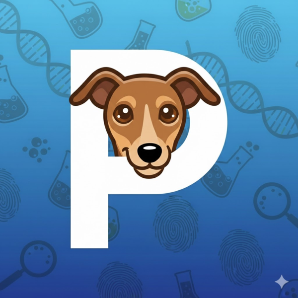

<div align="center">

<!-- ===================================================================== -->
<!-- 00 // CLASSIFIED FORENSIC DOSSIER HEADER & OPTICAL BARCODE            -->
<!-- ===================================================================== -->

```ini
║▌║█║▌│║▌║▌█  DOCKET: PX-8664-IND  //  CLASSIFICATION: SOVEREIGN FORENSIC ARCHITECTURE  //  SEAL: INTACT  ║▌║█║▌│║▌║▌█
```

<a href="https://github.com/NPhaneendhar">
  
</a>

# `P . H . A . N . I . X`
### **PHANEENDHAR NITTALA — DIGITAL FORENSICS & CYBER INVESTIGATION ARCHITECT**

<!-- CRIMSON & PLATINUM MONOSPACE TELEMETRY STREAM -->


<br>

<!-- TITANIUM & CRIMSON COMMAND MATRIX -->
<p>
  <a href="https://nphaneendhar.github.io/phaneendhar-nittala-portfolio/"></a>
  <a href="https://nphaneendhar.github.io/P.H.A.N.I.X-FORENSIC-QR-ARCHITECT"></a>
  <a href="https://p-h-a-n-i-x-investigation-e-xpert.vercel.app"></a>
</p>
<p>
  <a href="https://nittala-forensic-suite.vercel.app"></a>
  <a href="https://p-h-a-n-i-x-python-learn.vercel.app"></a>
  <a href="https://www.linkedin.com/in/phaneendhar-nittala-a2a3443a1/"></a>
  <a href="mailto:nittalaphaneendhar@gmail.com"></a>
</p>

<!-- MICROFICHE TELEMETRY RIBBON -->
<p>
  
  &nbsp;
  
  &nbsp;
  
  &nbsp;
  
</p>

</div>

---

<!-- ===================================================================== -->
<!-- 01 // ASYMMETRIC BENTO-GRID OPERATOR DOSSIER                          -->
<!-- ===================================================================== -->

<table width="100%">
  <tr>
    <!-- LEFT TALL BENTO CARD (SPANS 3 ROWS) -->
    <td width="34%" rowspan="3" align="center" valign="top">
      <br>
      
      <br><br>
      <code>║▌║█║▌│║▌║▌█ PX-ID-001 ║▌║█║▌</code>
      <h3><b>PHANEENDHAR NITTALA</b></h3>
      <sub><b>FORENSIC SCIENTIST &amp; CYBER TOOLING ARCHITECT</b></sub>
      <br><br>
      
      <br><br>
      <div align="left">
      <blockquote>
        <b>FILE_REF</b>: <code>NITTALA-P-2026</code><br>
        <b>DISCIPLINE</b>: Digital Forensics &amp; Incident Response (DFIR)<br>
        <b>KERNEL</b>: Arch Linux (x86_64)<br>
        <b>FOCUS</b>: Cryptographic Integrity, Chain-of-Custody &amp; Local AI
      </blockquote>
      </div>
      <a href="https://nphaneendhar.github.io/phaneendhar-nittala-portfolio/">
        
      </a>
      <br><br>
    </td>
    <!-- TOP-RIGHT WIDE BENTO CARD (SPANS 2 COLUMNS) -->
    <td width="66%" colspan="2" valign="top">
      <h4><b><code>[SECTION 01.A]</code> // FORMAL EVIDENTIARY INTEGRITY AXIOM</b></h4>
      In digital forensics, a single flipped bit compromises an entire investigation. The <b>PHANIX Architecture</b> enforces strict mathematical non-repudiation across every artifact lifecycle:
      <br><br>
      $$\mathcal{V}_{\text{PHANIX}}(\mathcal{E}) = \text{SHA256}(\mathcal{E}_{\text{raw}}) \oplus \text{UUID}_{\text{custody}} \implies \text{Admissible} \iff \Delta_{\text{bit}}(\mathcal{E}_t, \mathcal{E}_0) = 0$$
    </td>
  </tr>
  <tr>
    <!-- MIDDLE-RIGHT SPLIT BENTO CARD 1 -->
    <td width="33%" valign="top">
      <h4><b><code>[01.B]</code> // HOST KERNEL</b></h4>
      <div align="center">
        <a href="https://archlinux.org/">
          
        </a>
      </div>
      <sub><i>"Windows asked me to restart. Arch asked me to understand."</i></sub>
      <br><br>
      <code>• OS     : Arch Linux x86_64</code><br>
      <code>• MOUNT  : Read-Only Loopback</code><br>
      <code>• SHELL  : POSIX / Bash / C</code>
    </td>
    <!-- MIDDLE-RIGHT SPLIT BENTO CARD 2 -->
    <td width="33%" valign="top">
      <h4><b><code>[01.C]</code> // CORE DOMAINS</b></h4>
      <code>[01]</code> <b>Disk &amp; Memory Forensics</b><br>
      <sub>Bit-stream cloning &amp; carving</sub><br><br>
      <code>[02]</code> <b>Cryptographic Custody</b><br>
      <sub>SHA-256 &amp; Optical QR Seals</sub><br><br>
      <code>[03]</code> <b>Air-Gapped Forensic AI</b><br>
      <sub>Local Ollama RAG case engines</sub>
    </td>
  </tr>
  <tr>
    <!-- BOTTOM-RIGHT WIDE BENTO CARD (SPANS 2 COLUMNS) -->
    <td width="66%" colspan="2" valign="top">
      <h4><b><code>[SECTION 01.D]</code> // OPERATIONAL TELEMETRY &amp; SUBSYSTEM CALIBRATION</b></h4>
```yaml
EVIDENCE_ACQUISITION_&_HASHING : ▰▰▰▰▰▰▰▰▰▰▰▰▰▰▰▰▰▰▰▰ 100% [SHA-256 / BIT-STREAM]
ARCH_LINUX_&_POSIX_AUTOMATION  : ▰▰▰▰▰▰▰▰▰▰▰▰▰▰▰▰▰▰▰▱  95% [KERNEL / BASH / C]
FORENSIC_WEB_HUD_ENGINEERING   : ▰▰▰▰▰▰▰▰▰▰▰▰▰▰▰▰▰▰▰▱  95% [REACT / ZXING / VITE]
OSINT_&_NETWORK_RECONNAISSANCE : ▰▰▰▰▰▰▰▰▰▰▰▰▰▰▰▰▰▰▱▱  90% [NMAP / PCAP / TRIAGE]
LOCAL_LLM_&_CASE_DOSSIER_RAG   : ▰▰▰▰▰▰▰▰▰▰▰▰▰▰▰▰▰▱▱▱  88% [OLLAMA / VECTOR_DB]
```
    </td>
  </tr>
</table>

---

<!-- ===================================================================== -->
<!-- 02 // STATE-MACHINE ARCHITECTURE: ARTIFACT CUSTODY LIFECYCLE          -->
<!-- ===================================================================== -->

<div align="center">

### `02 // PHANIX EVIDENTIARY STATE-MACHINE TOPOLOGY`

```mermaid
%%{init: {'theme': 'base', 'themeVariables': { 'primaryColor': '#0A0C10', 'primaryTextColor': '#E2E8F0', 'primaryBorderColor': '#FF2A54', 'lineColor': '#FF2A54', 'secondaryColor': '#12151C', 'tertiaryColor': '#0A0C10', 'fontFamily': 'monospace'}}}%%
stateDiagram-v2
    direction LR
    [*] --> Seized_Artifact
    Seized_Artifact --> Write_Blocked_Bus : Hardware Isolation
    Write_Blocked_Bus --> BitStream_Clone : Raw .DD / .E01 Image
    
    state "PHANIX CRYPTOGRAPHIC CORE" as CryptoCore {
        BitStream_Clone --> SHA256_Digest : Compute 256-Bit Hash
        SHA256_Digest --> UUID_Timestamp : Bind UTC + Operator ID
        UUID_Timestamp --> Optical_QR_Seal : Encode ZXing Matrix
    }
    
    Optical_QR_Seal --> Field_Scanner_Audit : Optical Webcam Read
    Field_Scanner_Audit --> Courtroom_Admissible : Parity == 100%
    Field_Scanner_Audit --> Tamper_Alert_0xFF : Bit Deviation Detected
    Courtroom_Admissible --> [*]
```

<sub><b>Real-time cryptographic state transitions from physical seizure to courtroom verification</b></sub>

</div>



---

<!-- ===================================================================== -->
<!-- 03 // FLAGSHIP DOSSIER: PHANIX FORENSIC QR ARCHITECT                  -->
<!-- ===================================================================== -->

> [!IMPORTANT]
> **FLAGSHIP PRODUCTION DEPLOYMENT // `PHANIX FORENSIC QR ARCHITECT`**  
> Designed for digital forensics field responders and evidence custodians requiring zero-trust client-side hashing and instant optical verification without uploading confidential files to external servers.

<table width="100%">
  <tr>
    <td width="50%" valign="top">
      <h3><b><code>SPECIFICATION SHEET // PX-QR-v4</code></b></h3>
```yaml
SYSTEM_NAME : PHANIX Forensic QR Architect
RUNTIME     : React 18 + Web Crypto SHA-256 Engine
OPTICAL_CORE: ZXing High-Density Matrix Decoder
PRIVACY_MODE: 100% Client-Side (Zero Server Upload)
OUTPUT_SPEC : Courtroom Chain-of-Custody Dossier
```
      <ul>
        <li><b>Zero-Trust Local Hashing</b>: Computes authentic SHA-256 digests directly in browser memory.</li>
        <li><b>Immutable Custody UUIDs</b>: Binds investigator credentials, UTC timestamps, and file metadata into an optical seal.</li>
        <li><b>Live Optical Scanner HUD</b>: Validates physical or digital QR evidence tags via webcam to expose single-bit tampering.</li>
      </ul>
      <a href="https://nphaneendhar.github.io/P.H.A.N.I.X-FORENSIC-QR-ARCHITECT">
        
      </a>
    </td>
    <td width="50%" align="center" valign="middle">
      <a href="https://nphaneendhar.github.io/P.H.A.N.I.X-FORENSIC-QR-ARCHITECT">
        
      </a>
      <br><br>
      <sub><code>[EXHIBIT A]</code> — Live Optical Verification &amp; Cryptographic Checksum Interface</sub>
    </td>
  </tr>
</table>

---

<!-- ===================================================================== -->
<!-- 04 // SOVEREIGN PRODUCTION NODES (4-CARD BENTO MATRIX)                -->
<!-- ===================================================================== -->

<div align="center">

### `04 // DEPLOYED INVESTIGATION & EDUCATIONAL PLATFORMS`

</div>

<table width="100%">
  <tr>
    <td width="50%" valign="top">
      <h4><b><code>[EXHIBIT 01]</code> // OPTICAL CUSTODY ENGINE</b></h4>
      <h3><a href="https://nphaneendhar.github.io/P.H.A.N.I.X-FORENSIC-QR-ARCHITECT">PHANIX Forensic QR Architect</a></h3>
      <sub><b>`React` • `SHA-256` • `ZXing Optical` • `Chain-of-Custody`</b></sub>
      <p>Cryptographic evidence identity generator and optical QR verification terminal for tamper-evident artifact sealing.</p>
      <a href="https://nphaneendhar.github.io/P.H.A.N.I.X-FORENSIC-QR-ARCHITECT">
        
      </a>
    </td>
    <td width="50%" valign="top">
      <h4><b><code>[EXHIBIT 02]</code> // UNIFIED RECON WORKBENCH</b></h4>
      <h3><a href="https://p-h-a-n-i-x-investigation-e-xpert.vercel.app">PHANIX Investigation Expert</a></h3>
      <sub><b>`Full-Stack JS` • `DFIR Triage` • `OSINT` • `Case UX`</b></sub>
      <p>Comprehensive digital investigation command deck combining forensic triage workflows, OSINT modules, and case reporting.</p>
      <a href="https://p-h-a-n-i-x-investigation-e-xpert.vercel.app">
        
      </a>
    </td>
  </tr>
  <tr>
    <td width="50%" valign="top">
      <h4><b><code>[EXHIBIT 03]</code> // ARTIFACT TRIAGE TOOLKIT</b></h4>
      <h3><a href="https://nittala-forensic-suite.vercel.app">Nittala Forensic Suite</a></h3>
      <sub><b>`Metadata Extraction` • `Binary Signatures` • `Hash Audit`</b></sub>
      <p>Dedicated forensic inspection laboratory for deep file header validation, EXIF/metadata carving, and integrity verification.</p>
      <a href="https://nittala-forensic-suite.vercel.app">
        
      </a>
    </td>
    <td width="50%" valign="top">
      <h4><b><code>[EXHIBIT 04]</code> // FORENSIC SCRIPTING LAB</b></h4>
      <h3><a href="https://p-h-a-n-i-x-python-learn.vercel.app">PHANIX Python Learn</a></h3>
      <sub><b>`Python 3` • `Automation` • `Interactive Labs` • `Parsers`</b></sub>
      <p>Interactive educational platform engineered to train students and investigators in Python programming and forensic automation.</p>
      <a href="https://p-h-a-n-i-x-python-learn.vercel.app">
        
      </a>
    </td>
  </tr>
</table>

---

<!-- ===================================================================== -->
<!-- 05 // TECHNICAL ARSENAL & HARDWARE/SOFTWARE MATRIX                    -->
<!-- ===================================================================== -->

<div align="center">

### `05 // TECHNICAL ARSENAL & FORENSIC TOOLCHAIN`

<table width="100%">
  <tr>
    <td width="33%" align="center" valign="top">
      <h4><code>LANGUAGES &amp; KERNEL SCRIPTING</code></h4>
      
      <br><br>
      <sub>Low-Level Bit Manipulation • POSIX Shell Pipelines • Cryptographic Hashing</sub>
    </td>
    <td width="34%" align="center" valign="top">
      <h4><code>APPLICATION &amp; UI ARCHITECTURE</code></h4>
      
      <br><br>
      <sub>High-Contrast Forensic HUDs • Containerized Labs • Automated Deployments</sub>
    </td>
    <td width="33%" align="center" valign="top">
      <h4><code>OS &amp; INVESTIGATION PLATFORMS</code></h4>
      
      <br><br>
      <sub>Arch Linux Rolling Kernel • Autopsy • Wireshark • Nmap • Local Ollama LLMs</sub>
    </td>
  </tr>
</table>

</div>

---

<!-- ===================================================================== -->
<!-- 06 // OBSIDIAN & CRIMSON TELEMETRY ANALYTICS                          -->
<!-- ===================================================================== -->

<div align="center">

### `06 // LIVE REPOSITORY TELEMETRY & COMMIT AUDIT`

<table width="100%">
  <tr>
    <td width="50%" align="center">
      
    </td>
    <td width="50%" align="center">
      
    </td>
  </tr>
  <tr>
    <td colspan="2" align="center">
      
    </td>
  </tr>
</table>

</div>

---

<!-- ===================================================================== -->
<!-- 07 // CLASSIFIED CASE DRAWERS (INTERACTIVE EXPANDABLE LOGS)           -->
<!-- ===================================================================== -->

<div align="center">

### `07 // DECLASSIFIED EVIDENCE DRAWERS (SELECT TO UNSEAL)`

</div>

<details open>
<summary><b>📕 [DOSSIER_01] // STANDARD OPERATING PROCEDURE: CHAIN-OF-CUSTODY &amp; ACQUISITION</b></summary>
<br>

```ini
[PROTOCOL_HEADER]
Standard     = ISO/IEC 27037 Digital Evidence Preservation
Host_System  = Arch Linux x86_64 (Write-Blocked Loopback)
Verification = Dual-Pass Cryptographic Parity

[EXECUTION_STAGES]
01_SEIZE     = Isolate physical/virtual target & engage hardware write-blocker
02_IMAGE     = Execute bit-stream raw capture (.dd / .E01) with zero source mutation
03_FINGERPRT = Compute SHA-256 digest across raw byte stream
04_SEAL      = Generate PHANIX Optical QR Seal containing hash + UTC timestamp
05_AUDIT     = Re-verify bit-level parity prior to courtroom export
```

</details>

<details>
<summary><b>📓 [DOSSIER_02] // ARCH LINUX FORENSIC TERMINAL PLAYBOOK</b></summary>
<br>

```bash
# [01] Bit-stream forensic acquisition with synchronized I/O & live progress:
[root@phanix-arch ~]# dd if=/dev/sdb of=evidence_image.raw bs=4M conv=noerror,sync status=progress

# [02] Generate cryptographic SHA-256 seal:
[root@phanix-arch ~]# sha256sum evidence_image.raw | tee evidence_image.raw.sha256

# [03] Mount image strictly READ-ONLY without modifying access timestamps:
[root@phanix-arch ~]# mount -o ro,loop,noatime,norecovery evidence_image.raw /mnt/evidence_ro

# [04] Carve high-entropy strings & inspect magic header signatures:
[root@phanix-arch ~]# file -k artifact.bin && strings -a -n 8 artifact.bin | grep -iE 'http|key|token|ssh'
```

</details>

<details>
<summary><b>📔 [DOSSIER_03] // CRYPTOGRAPHIC SIGNATURE VERIFICATION (TERMINAL EASTER EGG)</b></summary>
<br>

Execute this pipeline in any Linux, macOS, or WSL shell to decode the embedded PHANIX operator signature from raw hexadecimal:

```bash
echo "5b5048414e49582d444f53534945525d2043525950544f47524150484943205345414c205645524946494544202f2f204152434849544543543a205048414e45454e44484152204e495454414c410a" | xxd -r -p
```

</details>

---

<!-- ===================================================================== -->
<!-- 08 // SOVEREIGN DOCTRINE & ARCHIVAL SEAL FOOTER                       -->
<!-- ===================================================================== -->

<div align="center">

<table width="100%">
  <tr>
    <td align="center">
      <br>
      <code>[ 01. QUESTION ] ━━━▶ [ 02. ISOLATE ] ━━━▶ [ 03. ACQUIRE ] ━━━▶ [ 04. HASH ] ━━━▶ [ 05. VERIFY ] ━━━▶ [ 06. TESTIFY ]</code>
      <br><br>
      <h3><b>"Forensic science taught me to examine the evidence. Programming taught me to build the instruments. Cybersecurity taught me to anticipate the adversary. PHANIX is where they converge."</b></h3>
      <sub><b>EVERY FILE TELLS A STORY &nbsp;•&nbsp; EVERY LOG LEAVES A TRACE &nbsp;•&nbsp; EVERY BYTE CAN MATTER</b></sub>
      <br><br>
    </td>
  </tr>
</table>

<br>

<a href="https://github.com/NPhaneendhar">
  
</a>

### `P . H . A . N . I . X   //   F O R E N S I C   L A B S`

<p>
  <a href="https://github.com/NPhaneendhar"></a>
  <a href="https://nphaneendhar.github.io/phaneendhar-nittala-portfolio/"></a>
  <a href="https://www.linkedin.com/in/phaneendhar-nittala-a2a3443a1/"></a>
  <a href="mailto:nittalaphaneendhar@gmail.com"></a>
</p>

```ini
║▌║█║▌│║▌║▌█  EOF // © PHANEENDHAR NITTALA  //  ARCH LINUX x86_64  //  ALL ARTIFACTS VERIFIED  ║▌║█║▌│║▌║▌█
```

</div>
